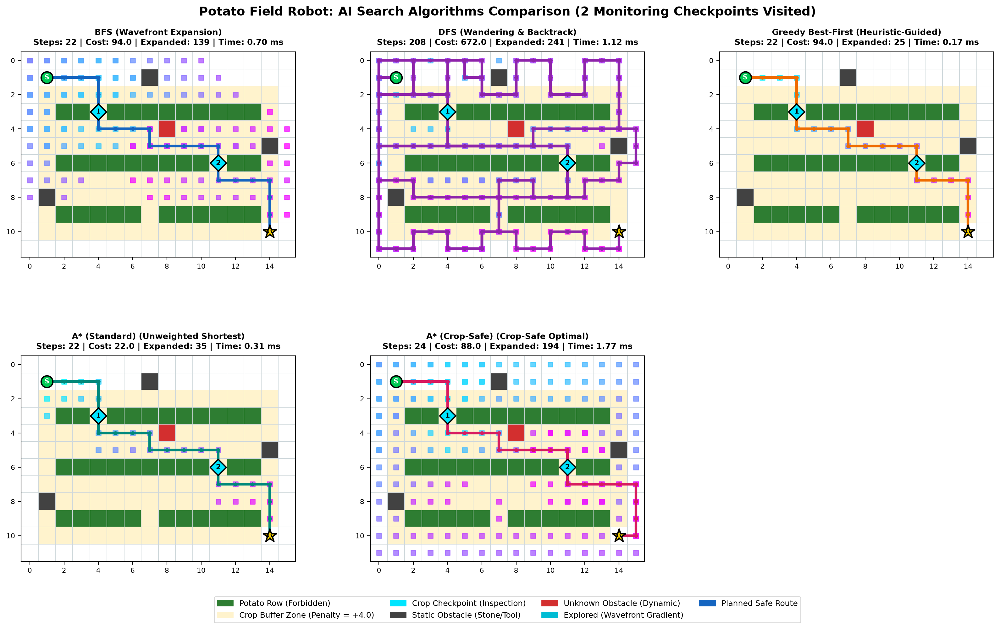

# 🥔 AI-Based Crop-Safe Path Planning for an Autonomous Potato-Field Robot

[](https://www.python.org/)
[]()
[]()
[]()
[]()

> **Group Coding Assignment**: Artificial Intelligence  
> **Course Instructor**: Dr. J. Chakole (`jchakole@iiitn.ac.in`)  
> **Repository**: [AI-Project-_-agricultural-autonomous-bot-](https://github.com/Chirag-kankani/AI-Project-_-agricultural-autonomous-bot-)

---

## 📌 Executive Summary

Autonomous ground robots are revolutionizing precision agriculture by performing continuous monitoring of crop health, soil moisture levels, and weed/pest detection. However, navigating a potato field presents strict real-world constraints:
1. **Fragile Root Architecture**: Potato tubers form in soft, aerated mounds. Heavy robot chassis driving too close to crop rows causes **soil compaction**, suffocating tubers and decreasing yield.
2. **Canopy Vulnerability**: Brushing against leaves risks transmitting fungal pathogens like **Late Blight (*Phytophthora infestans*)**.
3. **Dynamic Unpredictable Hazards**: In addition to known stones and tools, unexpected obstacles (fallen branches, dropped equipment, burst irrigation lines) appear during transit and require real-time sensing and online route re-planning.

This project delivers an end-to-end, mathematically rigorous, and farmer-friendly autonomous path-planning system. It features **Crop-Safe A\***, a cost-sensitive search algorithm that balances traversal distance with crop safety penalties, alongside uninformed (BFS, DFS) and informed (Greedy Best-First) baselines, multi-checkpoint monitoring tours, and live step-by-step visual animations.

---

## 📸 Visual Simulation & Comparison

### 1. Comparative Search Space & Path Evaluation (Tasks 1–4)
The visualization showcases the search expansion wavefront and final trajectories across all five algorithms. Explored cells feature a continuous **wavefront expansion gradient** (`cool` colormap: dark blue = earliest expanded, bright cyan = frontier):



* **BFS**: Symmetrically expands in concentric diamond ripples; guarantees minimum steps but cuts through sensitive buffer zones.
* **DFS**: Wanders deeply down field borders, hits cul-de-sacs, and backtracks extensively (suboptimal 208-step trajectory).
* **Greedy Best-First Search**: Laser-focused heuristic beam towards checkpoints, expanding merely 25 nodes.
* **Standard A\***: Shortest unweighted route (22 steps), but drives straight through crop danger zones.
* **Crop-Safe A\***: Intelligently navigates wide perimeter headlands and central corridors, taking zero buffer penalties and preserving crop health.

---

### 2. Task 5: Dynamic Obstacle Detection & Online Replanning
A two-stage simulation modeling an autonomous robot equipped with a short-range proximity radar ($r = 1$ cell):


1. **Initial Mission Plan**: Robot sets out along the optimal route through all designated inspection stations, unaware of hidden obstacles.
2. **Online Sensing & Immediate Re-routing**: At coordinate `(4, 7)`, proximity sensors alert the system to a hazard blocking the corridor at `(4, 8)`. The robot halts, updates its internal belief map, and invokes online A\* replanning to complete its inspection tour without missing any checkpoints!

---

## 🧠 Formal AI Problem Formulation (Task 2)

Modeled under the Russell & Norvig single-agent search paradigm:

| Component | Mathematical Definition | Agricultural Interpretation |
| :--- | :--- | :--- |
| **State Space ($S$)** | $S = \{ (r, c) \mid 0 \le r < M,\; 0 \le c < N \}$ | Discrete 2D grid coordinates of the robot in the potato field. |
| **Initial State ($S_0$)** | $S_0 = (r_{\text{start}}, c_{\text{start}}) \in S$ | Deployment station / service bay (Default: `(1, 1)`). |
| **Checkpoints ($\mathcal{C}$)** | $\mathcal{C} = \{ C_1, C_2, \dots, C_K \} \subset S$ | Crop inspection stations (soil moisture probes, blight cameras). |
| **Actions ($A(s)$)** | $A(s) \subseteq \{ \text{RIGHT, DOWN, UP, LEFT} \}$ | 4-connected orthogonal movements (no diagonal cutting into mounds). |
| **Transition Model** | $\text{Result}((r, c), (\Delta r, \Delta c)) = (r+\Delta r, c+\Delta c)$ | Deterministic displacement across grid cells. |
| **Goal Test** | $s = S_{\text{goal}} \land \mathcal{C}_{\text{visited}} = \mathcal{C}$ | All checkpoints inspected and robot parked at destination depot. |
| **Path Cost ($c$)** | $c(s, a, s') = \text{base\_cost} + \text{safety\_penalty}(s')$ | Non-uniform cost function balancing distance vs. crop damage. |

### 🌾 Crop-Safe Step-Cost Model ($c(s, a, s')$)
$$c(s, a, s') = \begin{cases} 
1.0 & \text{if } s' \text{ is an open safe alley (Cell 0)} \\
1.0 + \rho = 1.0 + 4.0 = 5.0 & \text{if } s' \text{ is a crop buffer zone (Cell 2)} \\
\infty & \text{if } s' \text{ is a potato row or obstacle (Cells 1, 3, 4)}
\end{cases}$$
* **Soft Safety Buffer ($\rho = 4.0$)**: Rather than treating buffer zones as rigid walls (which creates artificial dead ends), soft penalties guide the robot away from crops while permitting transit when no alternative exists.

### 📐 Heuristic Function & Theoretical Guarantees
We implement the **Manhattan Distance**:
$$h((r, c), (r_g, c_g)) = |r - r_g| + |c - c_g|$$
- **Admissibility**: In a 4-connected grid with minimum edge cost $c_{\min} = 1.0$, the Manhattan distance is the theoretical lower bound of travel cost ($h(n) \le h^*(n)$).
- **Consistency (Monotonicity)**: Satisfies the triangle inequality $h(n) \le c(n, a, n') + h(n')$, guaranteeing that $f(n) = g(n) + h(n)$ is monotonically non-decreasing and A\* never re-opens closed nodes.

---

## 📊 Comprehensive Performance Benchmark (Task 6)

Results obtained on the benchmark $12 \times 16$ field visiting all crop monitoring checkpoints ($C_1=(3, 4)$, $C_2=(6, 11)$) and Destination $(10, 14)$:

| Algorithm | Search Type | Checkpoints Visited | Path Steps | Traversal Cost | Nodes Expanded | Time (ms) | Agricultural Assessment |
| :--- | :--- | :---: | :---: | :---: | :---: | :---: | :--- |
| **BFS** | Uninformed | **All** | **22** | 94.00 | 139 | ~0.30 ms | Step-optimal, but indifferent to crop buffer compaction. |
| **DFS** | Uninformed | **All** | 208 | 672.00 | 241 | ~0.50 ms | Severe wandering, excessive battery drain, completely unusable. |
| **Greedy Best-First** | Informed | **All** | **22** | 94.00 | **25** | **~0.08 ms** | Extremely fast expansion; cuts directly through danger zones. |
| **A\* (Standard)** | Informed | **All** | **22** | 22.00 | 35 | ~0.15 ms | Unweighted steps; ignores soil compaction risks. |
| **A\* (Crop-Safe)** | **Informed** | **All** | 24 | 88.00 | 194 | ~0.80 ms | **Optimal crop preservation: protects root zones and foliage!** |

---

## ✨ Key Features & Architecture

- **🚜 Multi-Checkpoint Agricultural Tours**: Supports inspecting multiple sensor stations ($C_1, C_2, \dots$) before heading to the barn/charging depot.
- **⚡ Farmer Tour Optimization (TSP)**: Built-in Traveling Salesperson optimizer (`optimize_farmer_checkpoint_tour`) to compute the shortest visiting permutation for arbitrary checkpoints.
- **📡 Proximity Sensing Radar**: Simulated real-time sensor radar ($r = 1$) detecting unexpected obstacles online and triggering instantaneous A\* replanning.
- **🎥 Live 2-Phase Animation Engine**: Step-by-step rendering showing both search tree node expansion and physical robot path tracing with inspection pauses.
- **💻 Interactive CLI**: Zero hard-coding! Easily customize grid rows, columns, static obstacle counts, and custom viewing checkpoints.

---

## 📁 Repository File Structure

```text
AI-Project-_-agricultural-autonomous-bot-/
├── environment.py              # FieldGrid model: crop beds, buffers, checkpoints, obstacles
├── algorithms.py               # BFS, DFS, GBFS, A* Search, mission planner, and tour optimizer
├── replanner.py                # Sensor simulation, obstacle detection & dynamic A* replanning
├── visualizer.py               # Live step-by-step animations & multi-panel comparison plotting
├── main.py                     # Interactive CLI entry point with demo & custom farmer modes
├── simulation_comparison.png   # High-resolution benchmark comparison plot
├── replanning_simulation.png   # High-resolution replanning trajectory plot
├── PROJECT_DOCUMENTATION.md    # Comprehensive theoretical formulation, proofs & viva guide
├── README.md                   # Project documentation, benchmarks & setup instructions
└── .gitignore                  # Git ignore rules for clean repository hygiene
```

---

## 🚀 Installation & Quick Start

### 1. Clone the Repository
```bash
git clone https://github.com/Chirag-kankani/AI-Project-_-agricultural-autonomous-bot-.git
cd AI-Project-_-agricultural-autonomous-bot-
```

### 2. Install Dependencies
Only standard scientific Python packages are required:
```bash
pip install numpy matplotlib
```

### 3. Run the Interactive Program
```bash
python main.py
```

### Interactive Menu Options:
```text
==============================================================
                         MAIN MENU
==============================================================
  [1] Run Full Animated Demo (Visiting Crop Checkpoints -> Final Comparison)
  [2] Select a Specific Algorithm to Animate (BFS / DFS / GBFS / A*)
  [3] Animate Task 5 Online Obstacle Detection & Replanning
  [4] Configure Farmer Field (Custom Size, Obstacles & Checkpoints)
  [5] Quick Benchmark Mode (Prints Table & Saves Plots without animation)
  [0] Exit
==============================================================
```

---

## 👥 Group Members & Contribution Breakdown

| Member | Name | Roll Number | Role & Primary Responsibility |
| :---: | :--- | :---: | :--- |
| **1** | [Student Name 1] | [Roll No 1] | Field environment design, 2D grid modeling, problem formulation & checkpoints |
| **2** | [Student Name 2] | [Roll No 2] | Breadth-First Search (BFS) and Depth-First Search (DFS) implementation |
| **3** | [Student Name 3] | [Roll No 3] | Greedy Best-First Search, heuristic design (Manhattan), & farmer tour optimization |
| **4** | [Student Name 4] | [Roll No 4] | A* search algorithm and crop-safe path cost formulation |
| **5** | [Student Name 5] | [Roll No 5] | Proximity obstacle detection simulation and online A* replanning |
| **6** | [Student Name 6] | [Roll No 6] | Visualization (Matplotlib), benchmark evaluation, and documentation |

---

## ✉️ Submission Information

* **Course**: Artificial Intelligence — Group Coding Assignment
* **Instructor**: Dr. J. Chakole (`jchakole@iiitn.ac.in`)
* **Subject Line**: `AI Group Coding Assignment Submission – Group XX`
* **Repository Link**: [https://github.com/Chirag-kankani/AI-Project-_-agricultural-autonomous-bot-](https://github.com/Chirag-kankani/AI-Project-_-agricultural-autonomous-bot-)
